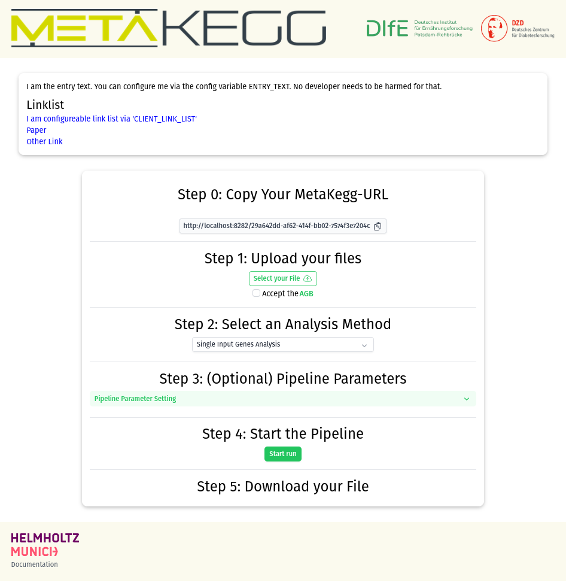

# MetaKeggWeb

Web interface for https://github.com/dife-bioinformatics/metaKEGG

Authors: [Justus Täger](https://orcid.org/0000-0002-3916-7815) [DZD](https://ror.org/04qq88z54), [Tim Bleimehl](https://orcid.org/0000-0002-2060-3920) [DZD](https://ror.org/04qq88z54)



- [MetaKeggWeb](#metakeggweb)
- [Install and Run](#install-and-run)
  - [Option1: Run with prebuild container](#option1-run-with-prebuild-container)
    - [Download](#download)
    - [Run](#run)
    - [Usage](#usage)
  - [Option2: Build and run with Docker](#option2-build-and-run-with-docker)
    - [Download](#download-1)
    - [Building](#building)
    - [Start](#start)
    - [Usage](#usage-1)
  - [Option3: Build and run locally](#option3-build-and-run-locally)
    - [Download](#download-2)
    - [Build Server](#build-server)
    - [Build Client](#build-client)
    - [Start](#start-1)
    - [Usage](#usage-2)
- [Configuration](#configuration)
  - [Via environment Variable](#via-environment-variable)
  - [Via Yaml file](#via-yaml-file)
    - [Local](#local)
    - [Docker](#docker)
- [Notes on running in production](#notes-on-running-in-production)
- [Data Security and Privacy Protection Design](#data-security-and-privacy-protection-design)
  - [Application-Level Security](#application-level-security)
    - [Pipeline Isolation and Access Control](#pipeline-isolation-and-access-control)
    - [Data Upload and Download Restrictions](#data-upload-and-download-restrictions)
    - [Data Deletion Controls](#data-deletion-controls)
    - [Transparency Through Open Source](#transparency-through-open-source)
  - [Operational Security](#operational-security)
    - [Transport Layer Security](#transport-layer-security)
    - [Storage Encryption at Rest](#storage-encryption-at-rest)
    - [Redis Security](#redis-security)
    - [Container Security](#container-security)
  - [Limitations and User Responsibilities](#limitations-and-user-responsibilities)
  - [Compliance Considerations](#compliance-considerations)


# Install and Run

> [!IMPORTANT]  
> This project is intended to run in  a Linux/Unix environment. It should also be able to run in a MS Windows environment but was not tested yet. There ~~may be~~ are still bugs regarding Path resolutions on MS Windows.


##  Option1: Run with prebuild container


### Download

`docker pull dzdde/metakeggweb` 

### Run

`docker run -p 8282:8282 dzdde/metakeggweb` 

### Usage

visit http://localhost:8282 to use the MetaKegg WebClient

visit http://localhost:8282/docs to see the OpenAPI Rest Specification

##  Option2: Build and run with Docker

**requirements**

* `git` for downloading the project 
  *  https://www.python.org/downloads/
* `docker` For building and running the project
  * https://docs.docker.com/engine/install/

### Download

`git clone git@github.com:DZD-eV-Diabetes-Research/meta-kegg-web-wrapper.git`

`cd meta-kegg-web-wrapper`

### Building

`docker build . -t metakeggweb`

### Start

`docker run -p 8282:8282 metakeggweb` 

### Usage

visit http://localhost:8282 to use the MetaKegg WebClient

visit http://localhost:8282/docs to see the OpenAPI Rest Specification


##  Option3: Build and run locally

**requirements**

* `git` for downloading the project 
  *  https://www.python.org/downloads/
* `python` >= v.3.11 for building and running the server
  * https://www.python.org/downloads/
* `bun` for building the Webclient 
  * https://bun.sh/docs/installation

### Download

`git clone git@github.com:DZD-eV-Diabetes-Research/meta-kegg-web-wrapper.git`

`cd meta-kegg-web-wrapper`

### Build Server

`python -m pip install -r ./backend/requirements.txt -U`

There are some mandatory config setting we need to set.
create a .env file at `backend/mekeweserver/.env`
Write this content into the file `backend/mekeweserver/.env`

```
SERVER_HOSTNAME=localhost
```

### Build Client


Download and install depencencies for client  

`(cd frontend && bun install)`

Build static pages for the client  

`(cd frontend && bunx nuxi generate)`


### Start

Finally we can start the MetaKegg Webserver with:

`python backend/mekeweserver/main.py`

### Usage

visit http://localhost:8282 to use the MetaKegg WebClient

visit http://localhost:8282/docs to see the OpenAPI Rest Specification


# Configuration

MetaKegg has a range of configuration variables. Most are set to sane default values.

Have a look at [config.template.yaml](config.template.yaml) to see a template with all possible configuration parameters.

## Via environment Variable

You can set any configuration variable via env vars. This is convenient via Docker

For example lets define the log level in our instance.

`docker run -p 8282:8282 -e LOG_LEVEL=INFO metakeggweb` 

## Via Yaml file

If you want to MetaKeggWeb to use a custamized config yaml file, set the environment variabel `MEKEWESERVER_YAML_CONFIG_FILE` with a path pointing to your yaml.

Lets create a config yaml first

`/tmp/config.yaml`
```yaml
LOG_LEVEL: INFO
PIPELINE_RUNS_CACHE_DIR: /tmp/mekewe_cache
```

### Local

Now we want to set `MEKEWESERVER_YAML_CONFIG_FILE` to point to our yaml file

~~On MS Windows:~~
~~`set MEKEWESERVER_YAML_CONFIG_FILE="C:\tmp\config.yaml"`~~

On *nix:
`export MEKEWESERVER_YAML_CONFIG_FILE="/tmp/config.yaml"`


If we now start our webserver with  
`python backend/mekeweserver/main.py`  
Our `config.yaml` will be taken into account.

### Docker

With docker we only need to mount our `config.yaml` into the `config` directory.

`docker run -p 8282:8282 -v /tmp/config.yaml:/config/config.yaml metakeggweb` 


# Notes on running in production

MetaKeggWeb uses a Redis server for interprocess communication.  
If no Redis server is provided, the Webserver will run an instance of [`fakeredis`](https://pypi.org/project/fakeredis/).
This is fine for running a local demo. 
  
For a productive instance you should attach a real Redis instance to the server.
Have a look at our [`docker-compose.yaml`](docker-compose.yaml) reference file to see how to do it.

# Data Security and Privacy Protection Design

MetaKegg Webwrapper implements several security measures to protect potentially sensitive bioinformatics data uploaded by users.

## Application-Level Security

### Pipeline Isolation and Access Control

Each pipeline definition is protected by a cryptographically secure UUID4 identifier. These 128-bit random identifiers make unauthorized access through enumeration computationally infeasible. Without the complete pipeline URL, users cannot discover or access pipeline configurations or results.

### Data Upload and Download Restrictions

Uploaded input files cannot be downloaded from the system, even if the pipeline URL is exposed. Only the aggregated result files generated by the metaKEGG analysis are available for download. This prevents scenarios where sensitive raw sequencing data or metadata could be extracted by unauthorized parties.

### Data Deletion Controls

Users have full control over their data lifecycle through two mechanisms:

- **Manual deletion**: Users can delete any pipeline with all associated files at any time through the web interface, providing immediate data removal when needed.
- **Automatic expiration**: All pipeline definitions, uploaded files, intermediate results, and metadata are automatically deleted after the retention period specified by `PIPELINE_RESULT_DELETED_AFTER_MIN`. This time-limited retention reduces the window of opportunity for unauthorized access and ensures compliance with data minimization principles.

Administrators should configure the automatic retention period based on their security requirements, while users retain the ability to delete data earlier if desired.

### Transparency Through Open Source

The complete source code is publicly available for review by security researchers, data protection officers, and end users before deployment or data upload. This enables independent security audits and allows organizations to verify security claims.

## Operational Security

### Transport Layer Security

MetaKegg Webwrapper must be deployed behind an SSL/TLS-secured reverse proxy to encrypt all data in transit. Production deployments should use certificates from a trusted certificate authority and enforce HTTPS.

### Storage Encryption at Rest

All storage volumes containing pipeline data, uploaded files, and results should be encrypted at rest using appropriate disk encryption, cloud provider encryption services, or filesystem-level encryption.

### Redis Security

Production deployments using a dedicated Redis instance should bind Redis to localhost or internal networks only, enable authentication, and consider using TLS for network communication.

### Container Security

When deploying via Docker, follow standard container security practices including running as non-root users, using read-only mounts where appropriate, and regularly updating base images.

## Limitations and User Responsibilities

Users should be aware of the following limitations:

- **Pipeline URLs are bearer tokens**: Anyone with access to a pipeline URL can access that pipeline's results. Treat URLs as secrets and transmit only through secure channels.

- **No user authentication**: The system does not implement per-user authentication. All security relies on keeping pipeline URLs confidential.

- **Metadata exposure**: Pipeline metadata such as creation timestamps and file names are accessible to anyone with the pipeline URL. Avoid including sensitive information in filenames.

For organizations with strict security requirements, consider deploying a dedicated instance rather than sharing infrastructure.

## Compliance Considerations

When processing data subject to regulatory requirements (GDPR, HIPAA, institutional guidelines), administrators must ensure that retention periods, data processing agreements, and access controls comply with applicable regulations. The combination of manual deletion capability and automatic data expiration supports data minimization principles and enables users to exercise control over their data. Retention periods must be configured appropriately for the specific jurisdiction and use case.